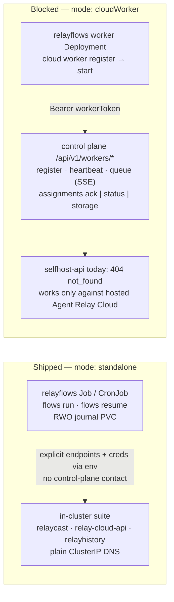

# Self-hosted Agent Relay — architecture diagram (GCP)

Rendered exports of the diagrams below: [architecture SVG](self-hosted-architecture.svg) ·
[architecture PNG](self-hosted-architecture.png) ·
[relayflows modes SVG](self-hosted-relayflows-modes.svg) ·
[relayflows modes PNG](self-hosted-relayflows-modes.png).
They are generated from the mermaid source in this file with
`@mermaid-js/mermaid-cli`; the mermaid blocks are the source of truth.

> **The architecture SVG and PNG are stale.** The mermaid source below was
> corrected (native GCS through Workload Identity,
> Secret-held database URLs, operator-run VolumeSnapshots, no external route to
> AlleyOop, planned Sessions search/replay) after they were rendered. Re-render
> them with `mmdc` before relying on the images.

One Helm release (`charts/agent-relay`) deploys the full suite into the
customer's GKE cluster and VPC-adjacent managed services. All public traffic
terminates at a single global external HTTPS load balancer on one static IP
with one Google ManagedCertificate covering four customer DNS names; every
backend is a `ClusterIP` Service reached through standalone NEGs, and
NetworkPolicy admits only same-namespace pods plus the Google Front End
ranges. Inside the namespace, Relaycast serves agent messaging over
WebSocket and REST, the control API serves sign-in, tenancy, and credential
exchange, RelayAuth issues scoped JWTs (and, in the model-B layout, pushes
`ar_ws_` workspace keys into Relaycast), AlleyOop ingests session chunks into
the GCS Locker bucket for the 96Bulls workers to index into PostgreSQL, and
RelayHistory receives the Desktop's durable delivery batches directly and
serves search and replay over them. AlleyOop is `ClusterIP`-only with no
ingress route, so it accepts chunks only from in-cluster callers. Durable state
is split deliberately: Cloud SQL holds per-service PostgreSQL databases with a
runtime/migration-owner role split, reached through connection URLs held in
Kubernetes Secrets (no IAM database authentication); GCS holds session
objects, reached by the 96Bulls workers and AlleyOop through the services'
native GCS adapter (`locker.provider: gcs`, `LOCKER_PROVIDER=gcs`) with GKE
Workload Identity on their Kubernetes service accounts, so no storage key is
stored; and retained RWO PVCs hold the Relaycast and RelayAuth SQLite stores. The
chart renders no `VolumeSnapshot` objects and Relaycast's backup CronJob is
off by default: PVC snapshots are operator-run per the
[backup and restore runbook](../selfhost-backup-restore.md). Credentials arrive
via existing Secrets, never values, with one exception: the optional
Relayflows `credentials.enrollmentToken` can be set inline and the chart
renders it into a Secret (prefer `credentials.existingSecret`). The bridge that
would feed 96Bulls Sessions into RelayHistory for search and replay is planned,
not implemented. Relayflows is an opt-in add-on; a Terse durable-actors
backend for Relaycast is designed but not yet shipped.

```mermaid
flowchart TB
  subgraph Clients["Client edge"]
    Desktop["Agent Relay Desktop<br/>trusted API origin"]
    Agents["CLI / SDK agents<br/>WSS + REST · cast host only"]
    Browser["Team members' browsers"]
  end

  subgraph LBEdge["Google global external HTTPS load balancer"]
    direction TB
    LB["Static IP 34.x.x.x<br/>GKE Ingress · class gce"]
    Cert["ManagedCertificate<br/>root · api · cast · history"]
    FE["FrontendConfig<br/>HTTP → HTTPS 301"]
    Deny["cast edge-deny Service<br/>no endpoints"]
    LB --- Cert
    LB --- FE
    LB -. "/internal + /v1/workspaces (exact)<br/>refused at the edge" .-> Deny
  end

  subgraph NS["GKE · agent-relay namespace"]
    direction TB
    Dash["relay-dashboard<br/>nginx SPA · :8080"]
    API["relay-cloud-api<br/>control plane · svc :80 → :3000<br/>device auth · orgs · workspace resolve"]
    Cast["relaycast<br/>WSS + REST · :8787<br/>single-writer engine"]
    Auth["relayauth<br/>JWT issuer · :8787 · optional"]
    Hist["relayhistory<br/>durable delivery · search · replay · :8080"]
    AO["alleyoop<br/>session-chunk ingest · :8080<br/>verifies RelayAuth JWKS<br/>ClusterIP only · no ingress route"]
    Producer["in-cluster callers only<br/>courier JWT<br/>external ingest: planned"]
    Worker["96bulls sessions workers<br/>index · summarize · eval · health :8081"]
    Flows["relayflows runner<br/>Job / CronJob · optional"]

    subgraph Planned["planned terse-actors backend — not shipped"]
      direction TB
      GW["relaycast gateway<br/>Bun · :8787"]
      CP["terse control plane ×2<br/>:7100"]
      SB["Workspace actor pods<br/>gVisor · terse-sandboxes ns<br/>engine on actor SQLite"]
      GW -->|"invoke Workspace[wsid]<br/>ar_ credential routes"| CP
      CP -->|"proxy invocation<br/>:7101/:7102"| SB
    end
  end

  subgraph Data["Customer GCP project · data plane"]
    direction TB
    SQL[("Cloud SQL PostgreSQL<br/>control-api · relayhistory · hoopdb<br/>runtime role ≠ migration owner<br/>URLs held in Secrets")]
    GCS[("Cloud Storage<br/>sessions Locker bucket + backup bucket<br/>native GCS API")]
    WI["GKE Workload Identity<br/>worker + alleyoop KSAs → GCS IAM<br/>storage only, not Cloud SQL"]
    TGCS[("future terse GCS — 4 bucket roles<br/>authority · artifact · archive<br/>· 2× zonal Rapid")]
    PVCs[("Retained RWO PVCs<br/>relaycast.db · relayauth.db · files")]
    Snap[("VolumeSnapshots — operator-run<br/>backup runbook · not rendered by the chart")]
    SM["Secret Manager /<br/>existing Kubernetes Secrets<br/>DB URLs · signing keys"]
  end

  Browser -->|"HTTPS root host"| LB
  Desktop -->|"HTTPS root + api hosts"| LB
  Agents -->|"WSS/HTTPS cast host"| LB

  LB -->|"root host /<br/>static SPA"| Dash
  LB -->|"root host /cloud/api + /login<br/>api host /"| API
  LB -->|"cast host /"| Cast
  LB -->|"history host /"| Hist

  Dash -->|"same-origin /cloud/api"| API
  API -->|"mint scoped assertions"| Auth
  API -->|"workspace key resolution<br/>/internal admin"| Cast
  API -->|"scoped history session issuance"| Hist
  API -->|"control-api database"| SQL
  Desktop -->|"durable delivery batches<br/>history host /v1/delivery"| Hist

  Auth -.->|"model B: RelayAuth owns the ar_ keyring,<br/>pushes ar_ws_ workspace keys;<br/>relaycast verifies via remote CredentialTagger"| Cast

  Producer -->|"session chunks · ClusterIP"| AO
  AO -->|"objects · native GCS"| GCS
  AO -->|"metadata"| SQL
  Worker -->|"read chunks · native GCS"| GCS
  Worker -->|"summaries · index"| SQL
  Worker -.->|"planned: hoopdb → RelayHistory bridge<br/>for session search · replay"| Hist
  Hist --> SQL
  Cast -->|"SQLite + files"| PVCs
  Auth --> PVCs
  Snap -.->|"operator-run backup"| PVCs
  WI -.->|"pod identity"| GCS
  SM -.->|"credentials at mount time"| NS
  Flows -->|"ClusterIP calls<br/>creds via env"| Cast

  GW -.->|"replaces engine pod<br/>when runtime.backend=terse-actors"| Cast
  SB -.-> TGCS
```

## Optional: Relayflows execution modes

`components.relayflows` is off by default. Standalone mode works against a
self-hosted install today; `cloudWorker` mode renders but cannot enroll until
the self-host control plane implements the `/api/v1/workers/*` family.

## Component map

| Diagram box | Chart / component | Port | Datastore |
| --- | --- | --- | --- |
| Global HTTPS LB | `gkeIngress` in `charts/agent-relay` | 443 (80 → 301) | static IP, ManagedCertificate, FrontendConfig |
| cast edge-deny Service | `gkeIngress` template | cast servicePort | none — selectorless, routes `/internal` and exact `/v1/workspaces` to nowhere |
| relay-dashboard | `charts/relay-dashboard` | 8080 (nginx SPA) | none |
| relay-cloud-api | `charts/relay-cloud-api` | svc 80 → container 3000 | Cloud SQL control-api DB (`control_api_runtime` + migration owner) |
| relaycast | `charts/relaycast` | 8787 WSS + REST | retained RWO PVC: `relaycast.db` + uploaded files; operator-run VolumeSnapshots (backup CronJob off by default) |
| relayauth | `charts/relayauth` (optional) | 8787 | retained RWO PVC: `relayauth.db`; signing key from Secret |
| relayhistory | `charts/relayhistory` | 8080 | dedicated Cloud SQL DB + migration ledger (never shares hoopdb) |
| alleyoop | `charts/96bulls` → `alleyoop` | 8080 (ClusterIP only, no ingress route) | GCS Locker bucket (native GCS, Workload Identity) + hoopdb (PG 17, `pg_trgm`) |
| 96bulls workers | `charts/96bulls-worker` | 8081 health | hoopdb + GCS Locker via native GCS and Workload Identity |
| relayflows | `charts/relayflows` (optional) | — | run-journal `ReadWriteOncePod` PVC |
| Cloud SQL | customer-provisioned | 5432 | per-service databases; runtime vs migration-owner role split; connection URLs from Secrets |
| GCS | customer-provisioned buckets | HTTPS, native GCS API | sessions Locker objects, recovery/backup prefixes; no stored key |
| Workload Identity | GKE KSA → GCP service account → bucket IAM | — | grants worker and AlleyOop KSAs GCS object access; databases still use Secret-held URLs |
| VolumeSnapshots | operator-run, [backup runbook](../selfhost-backup-restore.md) | — | Relaycast and RelayAuth PVC recovery sets; not rendered by any chart |
| Secrets | existing Secrets or Secret Manager (ESO) | — | DB URLs, signing keys, internal secrets; Relayflows enrollment token unless set inline (then chart-rendered) |
| terse control plane (planned) | vendored `charts/terse`, `components.terseActors` | 7100 | terse Postgres registry + 4 GCS bucket roles (authority, artifact, archive, 2× zonal Rapid) |
| Workspace actors (planned) | gVisor sandbox pods, `terse-sandboxes` ns | 7101/7102 | actor SQLite derived per activation from GCS logs/snapshots |
| relaycast gateway (planned) | `charts/relaycast` `runtime.backend=terse-actors` | 8787 | file blobs on PVC until an object-store backend lands |

## Key flows

- **Agent messaging:** agent → `cast` host → relaycast :8787 (WSS + REST) →
  SQLite/files on its RWO PVC. With the planned `terse-actors` backend, the
  pod becomes a stateless gateway: the `ar_` credential names the workspace,
  the terse control plane proxies the invocation to a `Workspace` actor pod,
  and the actor's SQLite is derived from GCS logs/snapshots.
- **Sessions:** session chunks from in-cluster callers → alleyoop :8080
  (courier JWT verified against RelayAuth JWKS; `ClusterIP` only, with no
  ingress route, so external agents cannot reach it today) → objects in the
  GCS Locker bucket + metadata in hoopdb → 96Bulls workers index/summarize
  into PostgreSQL. **Planned, not implemented:** a bridge from hoopdb into
  RelayHistory so these sessions appear in Dashboard search and replay. No
  chart wires hoopdb into RelayHistory or the control API today.
- **Key issuance (model B):** RelayAuth owns the `ar_` tag keyring and pushes
  `ar_ws_` workspace keys into Relaycast's internal admin API; Relaycast
  verifies tags through RelayAuth's remote CredentialTagger.
- **Durable delivery:** the Desktop sends durable delivery batches
  (`/v1/delivery/batches`) directly to the `history` host → RelayHistory
  :8080 → its dedicated Cloud SQL database. This, not the Sessions pipeline,
  is what Dashboard search and replay read today.
